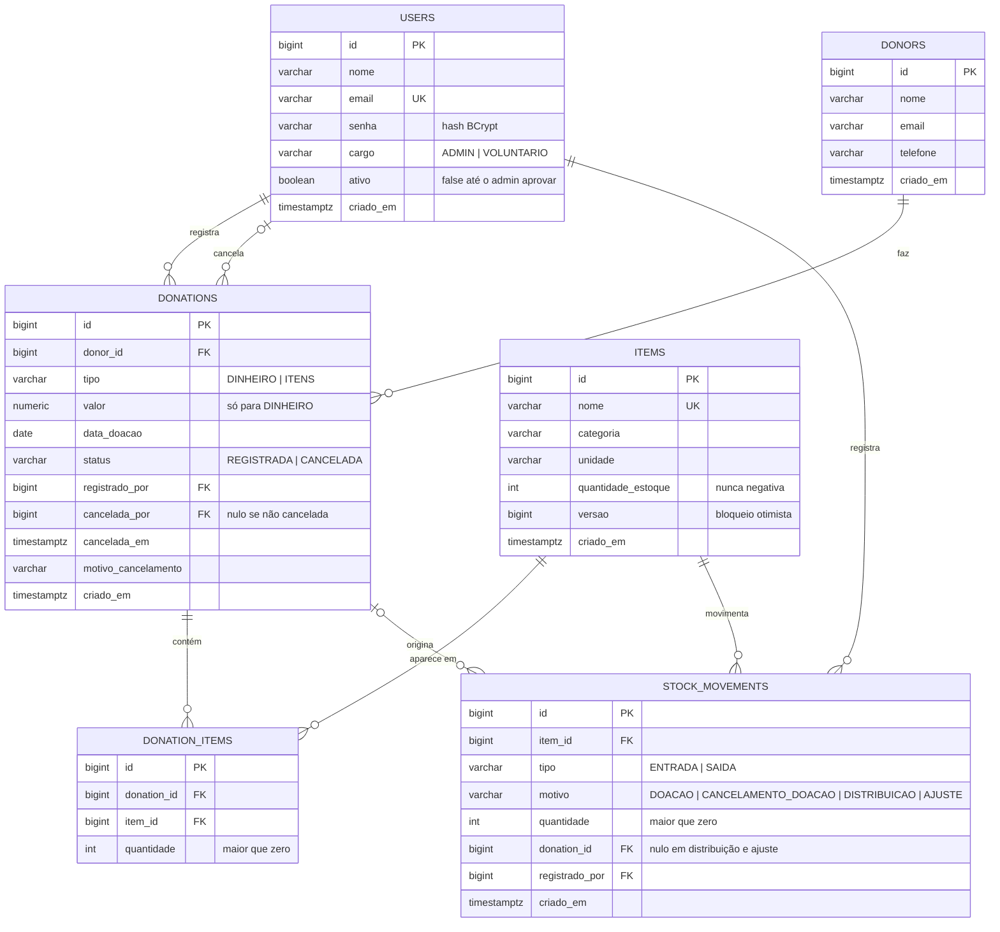

# API de Doações para ONG


API REST para uma ONG controlar **doações em dinheiro e em itens**, o **estoque** e o **cadastro de doadores e voluntários**. Voluntários se cadastram e só entram depois de aprovados por um administrador; toda mudança no estoque fica registrada em um histórico imutável.

## Funcionalidades

- Cadastro público de voluntários, com **aprovação do administrador** antes do primeiro acesso.
- Login com **JWT** e dois cargos: administrador e voluntário.
- CRUD de **doadores** e **itens** (com paginação e busca).
- Registro de **doações em dinheiro** e **de itens**; as de itens atualizam o estoque automaticamente.
- **Distribuição** de itens e **ajuste manual** de estoque, sempre com histórico.
- **Cancelamento** de doação com estorno do estoque.
- **Relatório mensal** de arrecadação em dinheiro.
- Documentação interativa com **Swagger UI**.

## Stack

- Java 17, Spring Boot 4 (Web MVC, Data JPA, Security, Validation)
- PostgreSQL 16 e Flyway (migrations versionadas)
- JWT com jjwt, API stateless
- Swagger
- Testes: JUnit, Mockito, Testcontainers e JaCoCo
- Docker, Docker Compose e GitHub Actions

## Como rodar

### Com Docker (um comando)

Requer Docker e Docker Compose.

```bash
cp .env.example .env      # ajuste as senhas e o JWT_SECRET
docker compose up --build
```

A API sobe em `http://localhost:8080`. Abra o Swagger em `http://localhost:8080/swagger-ui.html`, faça login em `POST /auth/login` com o `ADMIN_EMAIL` e a `ADMIN_PASSWORD` do `.env` e cole o token em **Authorize**.

### Desenvolvimento (API pela IDE ou pelo terminal)

```bash
docker compose up -d db   # só o banco
cd backend
set -a; source ../.env; set +a
mvn spring-boot:run
```

Na IDE, cadastre as mesmas variáveis do `.env` na configuração de execução.

### Variáveis de ambiente

| Variável | Para que serve |
|---|---|
| `DB_NAME`, `DB_USER`, `DB_PASSWORD` | Banco de dados PostgreSQL |
| `JWT_SECRET` | Chave de assinatura dos tokens (mínimo de 32 caracteres) |
| `ADMIN_NOME`, `ADMIN_EMAIL`, `ADMIN_PASSWORD` | Primeiro administrador, criado na inicialização se não houver admin ativo |

O `.env` contém segredos e não vai para o Git. Use o `.env.example` como modelo.

## Permissões

| Ação | Voluntário | Admin |
|---|---|---|
| Registrar-se e fazer login | sim, após aprovação | sim |
| Aprovar, desativar e promover usuários | não | sim |
| Cadastrar, editar e consultar doadores | sim | sim |
| Excluir doador (só sem doações) | não | sim |
| Cadastrar, editar e consultar itens | sim | sim |
| Excluir item (só sem histórico) | não | sim |
| Registrar e consultar doações | sim | sim |
| Cancelar doação (estorna o estoque) | não | sim |
| Registrar distribuição de item | sim | sim |
| Ajuste manual de estoque | não | sim |
| Consultar histórico de estoque | sim | sim |
| Relatório mensal | não | sim |

Requisição sem token recebe **401**; com token, mas sem permissão, **403**.

## Endpoints

| Método e rota | Descrição | Acesso |
|---|---|---|
| `POST /auth/register` | Cadastro de voluntário (fica pendente) | público |
| `POST /auth/login` | Login, devolve o JWT | público |
| `GET /admin/users?ativo=` | Lista usuários (`ativo=false` mostra os pendentes) | admin |
| `PATCH /admin/users/{id}/approve` · `deactivate` · `promote` | Aprova, desativa ou promove | admin |
| `POST /donors` · `GET /donors?nome=` · `GET /donors/{id}` · `PUT /donors/{id}` | CRUD de doadores | autenticado |
| `DELETE /donors/{id}` | Exclui doador sem doações | admin |
| `POST /items` · `GET /items?nome=&categoria=` · `GET /items/{id}` · `PUT /items/{id}` | CRUD de itens | autenticado |
| `DELETE /items/{id}` | Exclui item sem histórico | admin |
| `POST /items/{id}/distributions` | Saída de estoque por distribuição | autenticado |
| `POST /items/{id}/adjustments` | Correção manual de estoque | admin |
| `GET /items/{id}/movements` | Histórico de estoque do item | autenticado |
| `POST /donations/money` · `POST /donations/items` | Registra doação em dinheiro ou de itens | autenticado |
| `GET /donations?doadorId=&status=` · `GET /donations/{id}` | Consulta doações | autenticado |
| `POST /donations/{id}/cancel` | Cancela a doação e estorna o estoque | admin |
| `GET /reports/monthly?year=` | Arrecadação em dinheiro, mês a mês | admin |

## Modelo de dados

### Diagrama ER



### Regras garantidas pelo banco

- `donations`: DINHEIRO exige `valor > 0`; ITENS não tem valor; cancelada exige autor e data do cancelamento.
- `donation_items`: um item aparece uma única vez por doação (`UNIQUE (donation_id, item_id)`).
- `items`: estoque nunca negativo e nome único.
- `stock_movements`: DOACAO é sempre ENTRADA; CANCELAMENTO_DOACAO e DISTRIBUICAO são sempre SAIDA; movimentações ligadas a doação apontam para ela.
- Chaves estrangeiras sem `ON DELETE CASCADE`: doador, item ou usuário com histórico não podem ser excluídos.

## Decisões de projeto

- **Cadastro com aprovação.** O cadastro público cria sempre um voluntário inativo; o cargo nunca vem do corpo da requisição. Assim, abrir o cadastro não expõe os dados dos doadores.
- **JWT stateless, usuário consultado a cada requisição.** O servidor não guarda tokens: valida a assinatura e a expiração, e então carrega o usuário no banco. Por isso desativar um usuário ou mudar o cargo vale na hora, mesmo com o token ainda dentro do prazo. O custo é uma consulta por requisição.
- **Estoque por movimentações.** A quantidade de um item só muda pelo `StockService`, que grava um registro imutável de entrada ou saída na mesma transação. A quantidade de cada item é sempre igual à soma das suas movimentações, e um teste de integração confere isso.
- **Doação não se edita.** Em caso de erro, cancela-se e registra-se de novo. O cancelamento estorna o estoque com saídas próprias e é recusado se parte dos itens já foi distribuída.
- **Transações e concorrência.** Doação, itens, movimentações e quantidades gravam juntos ou não gravam. O item usa bloqueio otimista (`@Version`) e o cancelamento lê a doação com bloqueio de escrita, para duas operações simultâneas não estornarem o estoque duas vezes.
- **Regras no banco, além do código.** Migrations do Flyway com `CHECK` e chaves estrangeiras (estoque nunca negativo, doação em dinheiro com valor positivo, coerência entre tipo e motivo da movimentação). O Hibernate roda com `ddl-auto: validate`.
- **Exclusão com histórico é barrada.** Doador, item ou usuário com histórico não são excluídos (409); usuários são desativados.
- **Erros padronizados** no formato ProblemDetail, com a lista de campos nos erros de validação.
- **Dados pessoais.** Doadores têm nome, e-mail e telefone; guarde só o necessário (LGPD) e use dados fictícios em repositórios públicos.

## Testes

```bash
cd backend
mvn verify
```

Os testes de integração sobem um PostgreSQL descartável com **Testcontainers**, então precisam do Docker em execução. O relatório de cobertura (JaCoCo) fica em `backend/target/site/jacoco/index.html`.

- **Unitários:** serviços com Mockito e validações dos DTOs.
- **Integração (PostgreSQL real):** autenticação e permissões (401 e 403), fluxo de cadastro e aprovação, doações com estoque e cancelamento, exclusões bloqueadas e a consulta do relatório.

| Resultado | Valor |
|---|---|
| Testes | **105** <!-- TODO: preencher com o total de "mvn verify" --> |
| Cobertura de linhas (JaCoCo) | **91%** <!-- TODO: preencher com o valor do relatório --> |

O workflow de CI (`.github/workflows/ci.yml`) roda a suíte a cada push e sobe a aplicação com o Docker Compose para um teste de fumaça (login do admin).

## Limitações conhecidas e próximos passos

- Sem logout/revogação de token e sem refresh token (o token vale até expirar).
- Sem confirmação de e-mail, recuperação de senha ou limite de tentativas de login.
- Listagem de doações filtra só por doador e status.
- CORS ainda não configurado, porque não há front-end.
- O Swagger fica habilitado; em produção, desative com `springdoc.swagger-ui.enabled=false`.
- Próximos passos: front-end em React, deploy e endpoint de saúde (Actuator).
